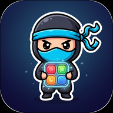
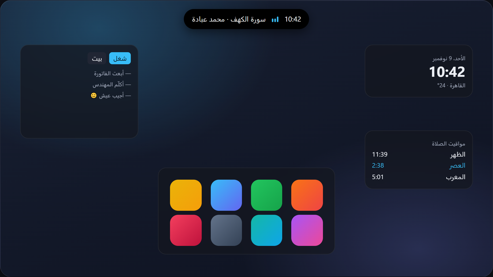
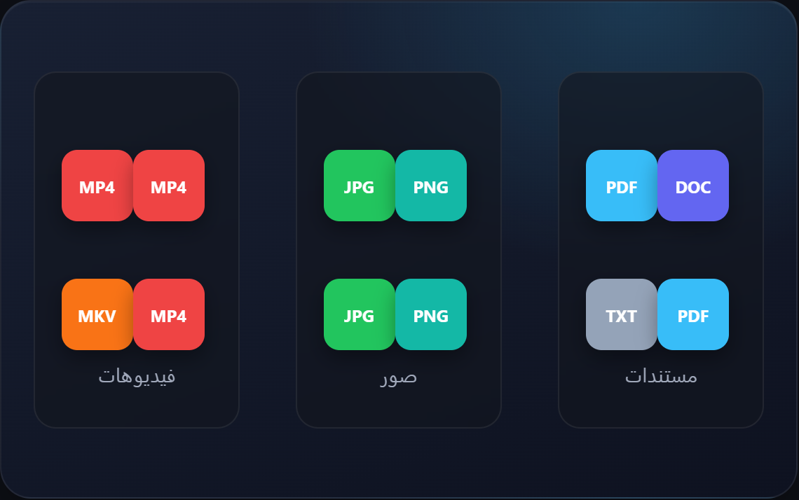
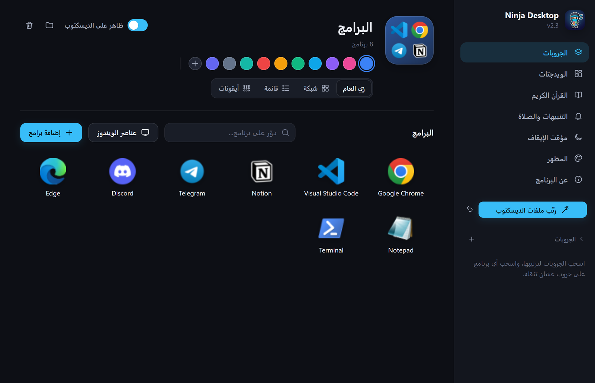
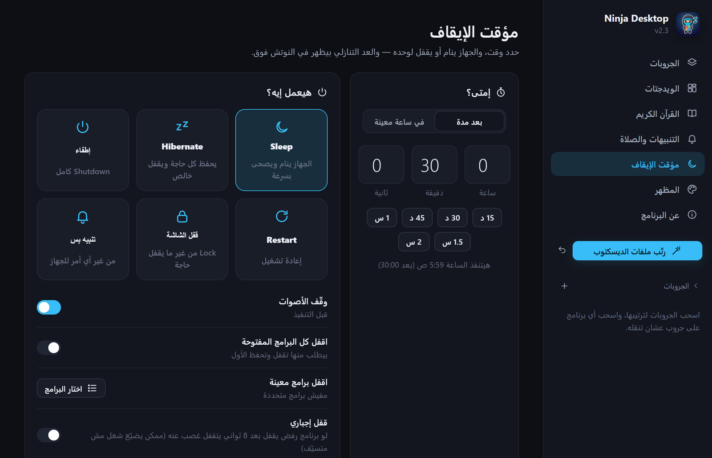
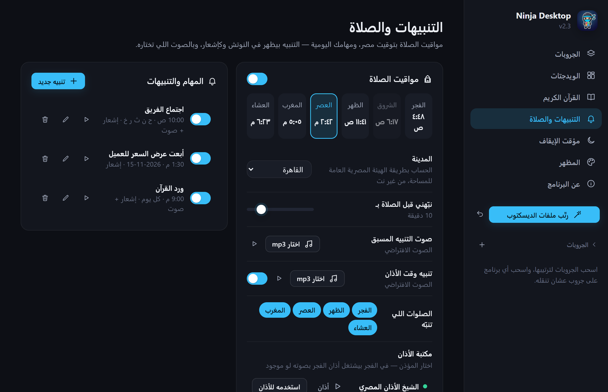
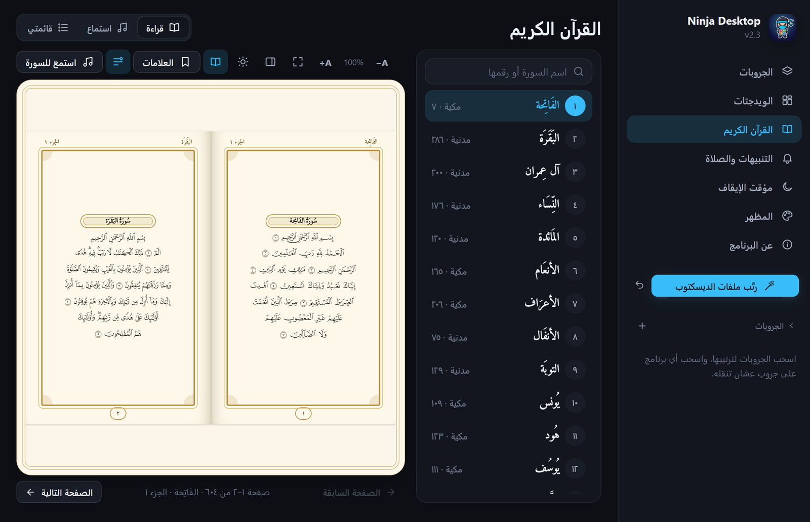
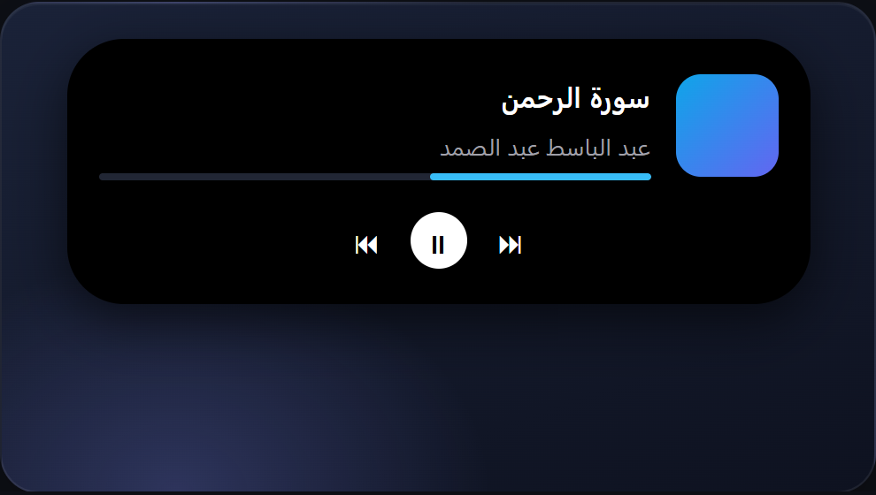
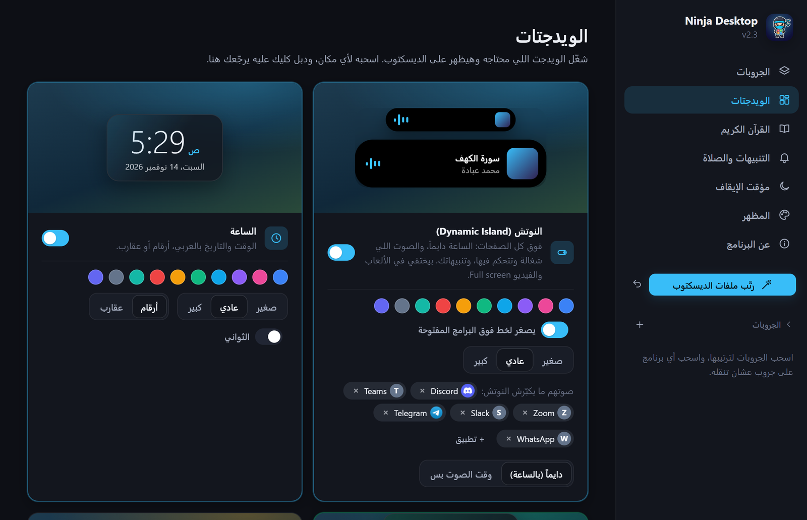
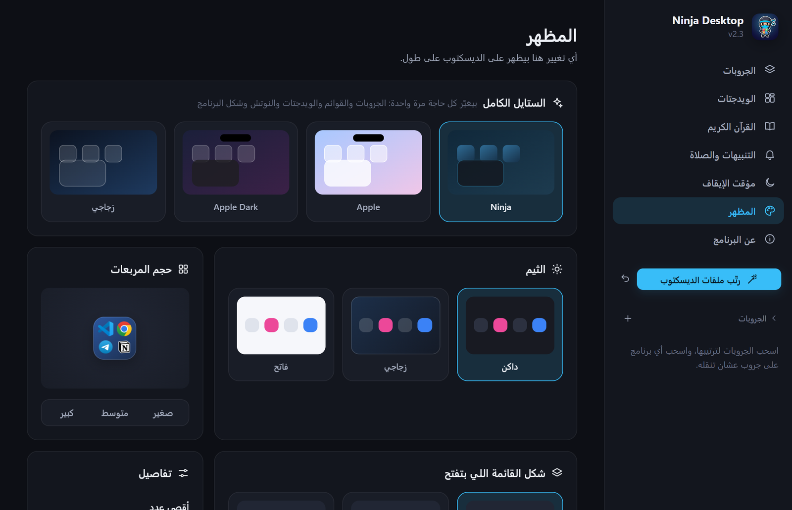

# Ninja Desktop

### سطح مكتب منظّم، خفيف، ومفيد — لويندوز 10 و 11

**[⬇️ تحميل البرنامج](https://github.com/Official-Abode/ninja-desktop/releases/latest)** &nbsp;·&nbsp; **[🌐 الموقع](https://desktop.subshub.net)** &nbsp;·&nbsp; **[📝 سجل التحديثات](https://desktop.subshub.net/changelog.php)**

 

## 📑 المحتويات

- [البرنامج بيحل إيه؟](#-البرنامج-بيحل-إيه)
- [ترتيب سطح المكتب](#️-ترتيب-سطح-المكتب)
- [مؤقت الإيقاف](#-مؤقت-الإيقاف)
- [التنبيهات ومواقيت الصلاة](#-التنبيهات-ومواقيت-الصلاة)
- [القرآن الكريم](#-القرآن-الكريم)
- [النوتش والويدجتات](#️-النوتش-والويدجتات)
- [المظهر](#-المظهر)
- [التثبيت](#-التثبيت)
- [أسئلة شائعة](#-أسئلة-شائعة)

 

## 💡 البرنامج بيحل إيه؟

| المشكلة | الحل في Ninja Desktop |
|:--|:--|
| 🗂️ سطح المكتب مكركب ومش لاقي حاجة | ضغطة واحدة بترتّب كل الملفات والبرامج في **جروبات** حسب نوعها |
| 🔁 الترتيب بيبوظ بعد الريستارت أو تغيير الشاشة | الجروبات **بترجع لأماكنها** لوحدها |
| 🌙 بتنام والجهاز شغال طول الليل | **مؤقت الإيقاف** يقفل البرامج ويعمل Sleep أو إطفاء بعد الوقت اللي تحدده |
| ⏰ بتنسى مواعيدك ومهامك | **تذكيرات** لمرة واحدة أو كل يوم أو أيام معينة |
| 🕌 الصلاة بتفوتك وأنت قاعد على الجهاز | **مواقيت الصلاة** لكل مدن مصر وتنبيه بصوت الأذان |
| 📖 عايز تقرا وتسمع قرآن من غير مواقع | **مصحف المدينة** بشكل الصفحات المطبوعة، وتفسير أي آية بضغطة |
| 🐢 برامج تقيلة بتبطّأ الجهاز | البرنامج بياخد حوالي **50 ميجا رام** بس |

 

## 🗂️ ترتيب سطح المكتب

> سطح مكتب مكركب؟ ضغطة واحدة وخلاص.

- زرار **«رتّب ملفات الديسكتوب»** بيفرز الفيديوهات والصور والمستندات والفولدرات، كل نوع في جروب.
- بيعرف البرامج المتسطّبة ويحطها في جروبات حسب نوعها (تصميم، برمجة، تواصل…).
- زرار **تراجع** بيرجّع كل حاجة مكانها لو النتيجة مش عاجباك.

ومن الإعدادات تتحكم في كل جروب: الاسم واللون والشكل (زي العام، شبكة، قائمة، أيقونات)، وتسحب البرامج من جروب لجروب.

 

## 🌙 مؤقت الإيقاف

> فكّرني… وبعدين اطفي الجهاز.

- **هيعمل إيه؟** Sleep، Hibernate، إطفاء، Restart، قفل الشاشة، أو تنبيه بس.
- **إمتى؟** بعد مدة (15 د، 30 د، ساعة…) أو في ساعة معينة.
- يقدر **يقفل كل البرامج المفتوحة** أو برامج معينة تختارها قبل التنفيذ.
- العد التنازلي بيظهر في النوتش فوق الشاشة.

 

## 🔔 التنبيهات ومواقيت الصلاة

> متفوّتش صلاة ولا ميعاد وأنت قاعد على الجهاز.

- مواقيت مظبوطة لكل مدن مصر (بطريقة الهيئة المصرية العامة للمساحة).
- تنبيه قبل الصلاة بوقت تحدده، وتنبيه وقت الأذان بأصوات أذان جاهزة أو أي ملف mp3.
- **مهام وتذكيرات** لمرة واحدة أو كل يوم أو أيام معينة في الأسبوع، بإشعار أو صوت.

 

## 📖 القرآن الكريم

> المصحف والتفسير والقرّاء في مكان واحد.

- **مصحف المدينة النبوية** (مجمع الملك فهد) برواية حفص عن عاصم، بنفس شكل الصفحات المطبوعة.
- **تفسير أي آية بضغطة**: التفسير الميسر وتفسير الطبري.
- تكبير الخط، ووضع قراءة بيخلّي المصحف ياخد الشاشة كلها، وعلامات تكمّل منها.
- استماع لقرّاء كتير، وقائمة تشغيل خاصة بيك، وتقدر تضيف ملفات صوت من عندك.

 

## 🏝️ النوتش والويدجتات

> كل اللي محتاجه، على سطح المكتب على طول.

- **النوتش**: الساعة فوق الشاشة دايمًا، ولما يشتغل صوت بيكبر ويعرض اللي شغال مع أزرار التحكم.
- تختار التطبيقات اللي صوتها **ما يكبّرش النوتش** (زي ديسكورد وتيمز وزووم).
- **ويدجتات** تحطها في أي مكان: الساعة، مواقيت الصلاة، التقويم، الطقس، أداء الجهاز، الشبكة، بومودورو، ملاحظات، سلة المحذوفات.

 

## 🎨 المظهر

> غيّر الشكل كله بضغطة.

- **ستايلات كاملة**: Ninja و Apple و Apple Dark و زجاجي — بتغيّر الجروبات والقوائم والويدجتات والنوتش مرة واحدة.
- **ثيم** داكن أو زجاجي أو فاتح، وتختار حجم المربعات وشكل القائمة.

 

## 📥 التثبيت

| | |
|:--:|:--|
| **1** | حمّل `NinjaDesktop-Setup-x.x.x.exe` من **[صفحة الإصدارات](https://github.com/Official-Abode/ninja-desktop/releases/latest)** |
| **2** | شغّل الملف. لو ظهر **«Windows protected your PC»** دوس **More info** ← **Run anyway** |
| **3** | البرنامج بيفتح لوحده. افتح الإعدادات واختار الأدوات اللي تعجبك |

**المتطلبات:** Windows 10 أو 11 · .NET Framework 4.8 · WebView2 (الاتنين موجودين أصلًا في أغلب الأجهزة) · من غير صلاحيات أدمن.

**التحديثات:** البرنامج بيبلّغك لوحده لما تنزل نسخة جديدة.

 

## ❓ أسئلة شائعة

<b>البرنامج مجاني؟</b>

أيوه، مجاني بالكامل ومن غير إعلانات. البرنامج صدقة جارية.

<b>ظهرلي «Windows protected your PC» — أعمل إيه؟</b>

ده تحذير SmartScreen بيظهر للبرامج الجديدة. دوس **More info** وبعدين **Run anyway** والتثبيت هيكمل عادي.

<b>هل هيتقّل الجهاز؟</b>

لا. البرنامج بياخد حوالي 50 ميجا رام، ومفيش أي hooks شغالة في الخلفية بتراقب الكيبورد أو الماوس.

<b>هل البرنامج بيجمع بيانات عني؟</b>

لا. البرنامج بيبعت رقم عشوائي مالوش علاقة بيك ورقم النسخة بس، عشان نعرف عدد الناس اللي بتستخدمه. مفيش اسم ولا إيميل ولا ملفات.

<b>إزاي أشيل البرنامج؟</b>

إعدادات ويندوز ← التطبيقات ← Ninja Desktop ← إلغاء التثبيت.

<b>لقيت مشكلة أو عندي اقتراح؟</b>

افتح **[Issue جديد](https://github.com/Official-Abode/ninja-desktop/issues)** واكتب اللي حصل، ولو تقدر ابعت صورة.

 

---

معمول بإيد مصرية — **Abdelrhman Hamdy**

صدقة جارية على روح والدي **حمدي خليل خليل رشدان**
اللهم اغفر له وارحمه، واجعل قبره روضة من رياض الجنة.

لو البرنامج نفعك، ادعيله بالرحمة 🤍

